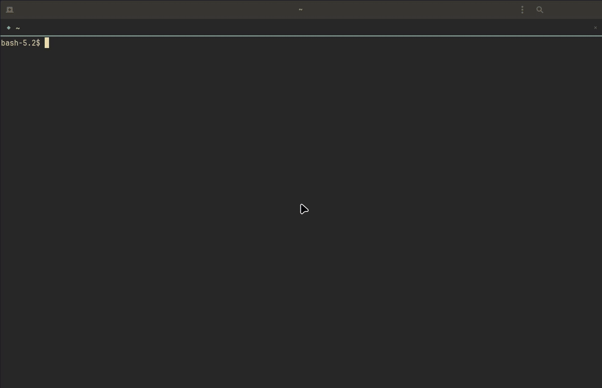
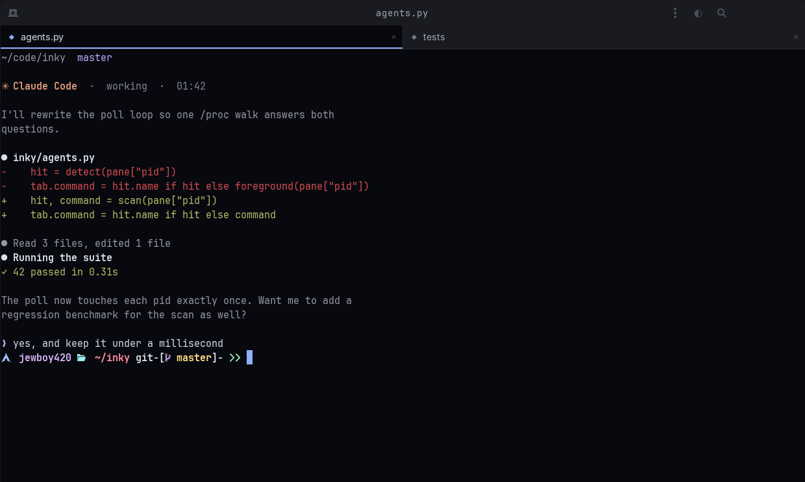

<p align="center">
  
</p>

<h1 align="center">Inky</h1>

<p align="center"><em>A quiet, fast terminal for people who live inside AI coding agents.</em></p>

<p align="center">
  
  
  
  
  
  
  
  
</p>

Inky is a terminal that assumes the thing running inside it is a coding agent.
Every tab is a real tmux session on a private socket, so closing the window never
kills a run in progress; Inky also notices *which* agent is in a tab, whether it is
working or waiting, and tells you when it needs you.

No Electron, no web view, no JavaScript shell. GTK3 + VTE, one Python process per
window, and a chrome made of hairlines so the grid is what you look at.



<sub>38 seconds, no cuts: search a theme and watch the whole window recolour, retype the
grid from the font wall, save a custom palette in the theme maker, broadcast one prompt
to every tab, then drop into zen mode. [Full-quality MP4](assets/demo.mp4)</sub>



## Why Inky

- **Agents survive everything.** Every tab is a tmux session (`inky-xxxxxxxx`). Close
  the window, log out of the desktop, crash the UI — the agent keeps its process and
  its scrollback. Relaunch `inky` and the exact tabs come back.
- **The terminal knows what is running in it.** Claude Code, Codebuff, Hermes, Codex,
  Mochi, Antigravity, Gemini, Crush, OpenCode, Aider, Cline, J-Code, Pi and Cursor
  Agent are detected from the process tree. The tab glyph becomes the agent's mark,
  and a desktop notification fires when it finishes or has been idle long enough to be
  waiting for you.
- **Built for long prompts and pasted context.** `Ctrl+Shift+Enter` opens a multi-line
  composer that sends as one bracketed paste. Clipboard images are saved to disk and
  pasted as a path, because a terminal cannot carry pixels but an agent can read a file.
- **Chrome you do not have to look at.** A full-width tab row that appears with the
  second tab, GNOME-style auto names (`opencode`, `nvim`, the folder for a bare shell),
  a hairline title bar, and 50 themes — plus a theme maker when none of them fit.
- **A font wall, not a font dialog.** Every installed font is listed and drawn in itself;
  one click retypes the terminal or the whole interface. Monospace-only for the grid, so
  agent tables and diffs never shear.
- **Cheap when idle.** Three idle tabs cost about 4 ms of work per poll tick and under
  0.2% of one core. Numbers and method below.

## How it compares

|  | **Inky** | Alacritty | Kitty | WezTerm | GNOME Terminal |
|---|---|---|---|---|---|
| Rendering | VTE / Cairo (CPU) | GPU (OpenGL) | GPU (OpenGL) | GPU (OpenGL) | VTE / Cairo (CPU) |
| Tabs | Full-width tab row | — (window manager) | ✓ | ✓ | ✓ |
| Session survives closing the window | ✓ built in (tmux) | — | — | ✓ opt-in mux server | — |
| Detects the running AI agent, notifies when waiting | ✓ | — | — | — | — |
| Clipboard image → file path for the agent | ✓ | — | — | — | — |
| Multi-line prompt composer (bracketed paste) | ✓ | — | — | — | — |
| Config | JSON | TOML | `kitty.conf` | Lua | GUI / dconf |
| Built-in colour schemes | 50 | — | — | — | a few schemes |
| Ships as | Python + GTK/VTE | Rust binary | C + Python | Rust binary | C + GTK |

Inky is honest about the trade-off: it is **not** GPU accelerated. GPU terminals win on
enormous grids at high refresh rates; VTE wins on layers, startup time, font rendering
consistency and the fact that it is already on every GNOME desktop. Inky spends its
optimisation budget on the parts that actually run all day — the poll loop, the chrome,
and the readability of agent output — instead of a shader pipeline.

## Performance

Measured on a Linux desktop, X11, VTE 0.76, three tabs, after the changes below:

| Metric | Before | After |
|---|---|---|
| Work per idle poll tick (3 tabs) | 66.5 ms | **3.85 ms** |
| Process walk per tab (agent + foreground) | 61.9 ms | **0.23 ms** |
| Idle CPU, 3 tabs, 15 s sample | — | **0.13%** of one core |
| Memory, 3 tabs | — | **67 MB PSS** (39 MB private; RSS reads 142 MB because GTK/VTE pages are shared) |

What changed:

- **One process walk per tab instead of two full system scans.** `psutil`'s
  `children(recursive=True)` re-reads every process on the box for every tab, and Inky
  did it twice (once to find an agent, once to name the tab). It now reads
  `/proc/<pid>/task/<pid>/children` and `/proc/<pid>/{stat,cmdline}`, answering both
  questions from one snapshot. `psutil` remains the fallback off Linux.
- **No crossfade between tabs.** A stack transition repaints two complete terminal grids;
  switching instantly is both smoother and cheaper.
- **No Pango churn at idle.** Tab and title markup are fingerprinted and only rebuilt when
  the value changes, instead of re-laying out the bar four times a second.
- **VTE scrollback is 2,000 lines, not 8,000.** tmux already owns 100,000 lines of
  history; VTE's ring buffer only has to cover what was printed before the first attach.
- **The bell is disabled** — agent CLIs ring it constantly, and each ring is a session-bus
  round trip.

The rest of the rendering budget is VTE's: it shape-caches glyphs, scrolls natively and
only repaints damaged cells. Inky adds no animation loop and no polling of terminal
contents unless an agent is actually running in that tab.

### Agent output readability

Coding agents paint a lot of their output in the dim end of the ANSI palette — comments,
diff context, metadata. On a dark theme those slots can sit one shade above the
background and read as smudges. Inky lifts every text slot in the palette to a minimum
WCAG contrast of **3.0** against the theme background (slot 0 is left alone; it *is* the
background), keeping each colour's hue. The body foreground is floored at 4.5, bold text
gets a dedicated high-contrast colour, and the default line height is 1.06.

The effect is easy to see on an agent that prints diffs and dimmed headings, and the floor
is configurable: set `behavior.min_contrast` to `0` for untouched palettes.

## Install

Requires Python 3.9+, GTK 3, VTE 2.91 and tmux.

```bash
# Debian / Ubuntu / Mint
sudo apt install python3-gi gir1.2-gtk-3.0 gir1.2-vte-2.91 tmux

# Arch
sudo pacman -S python-gobject gtk3 vte3 tmux

git clone https://github.com/xanstomper/inky.git ~/inky
cd ~/inky && ./install.sh
inky
```

`install.sh` symlinks `~/.local/bin/inky`, installs the logo at every hicolor size and a
desktop entry. Optional but recommended: `psutil` (agent detection), `xclip` or `wl-copy`
(mouse copy), `notify-send` (notifications). `inky doctor` reports what it found.

## Features

**Surface**
- Square, borderless CSD window that matches the terminal background, grid flush to the
  frame (`window.padding` adds breathing room).
- Full-width tab row: equal-width tabs, `✕` per tab, accent underline on the active one.
  Wheel over the row switches tabs; `Ctrl+Shift+PageUp/PageDown` reorders them.
- Title bar: `+` new tab, centered `tab · folder`, search, `☰` menu (themes live in the menu).
- GNOME Terminal naming: a tab is named after the running program (`opencode`, `nvim`,
  `ssh`), and after its folder when it is only a shell. Renaming pins the name.
- No status bar: the grid runs to the frame. Cwd and agent state live in the tab
  tooltip, the window title and notifications.

**Sessions that survive**
- Every tab is a tmux session on a private socket; closing the window never kills a run.
- Relaunch restores the exact tabs, with scrollback.
- `Ctrl+Shift+D` detaches a tab into its own window; `Ctrl+Shift+K` → **Sessions**
  reattaches any detached session.
- Many windows can run side by side, each owning its own tabs.

**Agent aware**
- Live agent detection from the process tree, with `working` / `waiting` state and runtime
  in the tab tooltip.
- Desktop notification when an agent finishes, and when it has been idle long enough to be
  waiting for you (throttled, quieter when you are looking at it).
- `Ctrl+Shift+A` launches any agent found on `PATH` in a fresh persistent tab.
- Prompt composer (`Ctrl+Shift+Enter`) — multi-line, `Shift+Enter` for newlines, sent as
  one bracketed paste.
- Clipboard images become `~/.cache/inky/paste/*.png` and are pasted as a quoted path.
- Drag files onto the terminal to paste quoted paths.
- Export any tab's full scrollback as markdown (`Ctrl+Shift+S`), path copied.
- Rename, duplicate, reorder, badge (green title when an agent just finished), close.

**Themes**
- **50 built-in schemes**: Inky, Catppuccin (Latte, Frappé, Macchiato, Mocha), Tokyo Night
  (+ Storm), Rosé Pine (+ Moon, Dawn), Kanagawa (+ Dragon, Lotus), Everforest
  (Dark, Light), Gruvbox (Dark, Light), Nord, Dracula, Solarized (Dark, Light), One Dark,
  One Light, Tomorrow Night (+ Blue), GitHub (Dark, Light), Ayu (Dark, Mirage), Material
  (Ocean, Palenight), Night Owl, Synthwave '84, Monokai Pro, Oceanic Next, Horizon,
  Zenburn, Iceberg, Spacegray, Cobalt2, Dark+, Flexoki, Jellybeans, Oxocarbon, Poimandres,
  Relaxed, Snazzy, Sonokai, Ubuntu, Vesper — plus any JSON you drop in
  `~/.config/inky/themes/`.
- `☰ → Themes…` (or `Ctrl+Shift+P`) opens a searchable theme list with
  a palette swatch per theme. Click once: the window recolours live and the choice is
  remembered. There is no giant submenu to hunt through.

**Theme maker**
- `Ctrl+Shift+M` opens a real colour editor: background, foreground, cursor, selection,
  accent and all 16 ANSI slots, each on a colour button.
- A live preview draws a miniature Inky window — titlebar dots, prompt, success/error
  lines, a selected span, a diff stat and a block cursor — in the palette you are
  building, at the real font metrics.
- Start from any of the 50 themes, then **Save & apply**: the theme is written to
  `~/.config/inky/themes/<slug>.json`, loaded and applied without restarting, and appears
  in the picker immediately. Built-in themes are never overwritten — forks get a
  `-custom` slug.
- **Import…** loads any exported theme JSON, **Export…** writes the current colours out,
  **Delete** removes your own themes only.

**Fonts & settings**
- `Ctrl+,` opens a three-page settings dialog. Everything applies live to the running
  session; nothing needs a restart.
- **Font wall** — every installed family, rendered in itself with a specimen line
  (`The quick brown fox 0123456789  ❯ ✓ ⚠ ⎇ 0O1l`), searchable, with Nerd Font badges.
  Switch the scope between **Terminal** (monospace only, 33 families here) and
  **Interface** (all 313 installed families). Agent output uses the terminal font.
- Font size (7–22 pt), weight (Light→Bold) and line height for the grid; separate size
  for the interface.
- Cursor shape and blink, the WCAG legibility floor (1.0–7.0), window padding and opacity.
- Terminal page: VTE scrollback, copy-on-select, scroll-on-output, scroll-on-keystroke,
  mouse autohide, audible bell.
- Agents page: finish/waiting notifications, close confirmation, poll interval.
- **Extras**: one-click zen mode, broadcast prompt, theme shuffle, and a shortcut to the
  themes folder.
- **Zen mode** (`Ctrl+Shift+Z`): hides the tab row and toolbar buttons and leaves only
  the grid. Same shortcut, `Escape`, or the `☰` menu brings the chrome back.
- **Broadcast prompt** (`Ctrl+Shift+B`): type one prompt in the composer and it is sent
  to every open tab — the same instruction fanned out across several agents at once.

**CLI**

```bash
inky                       # window, restoring last tabs
inky attach <session>      # attach a specific session in a new window
inky ls                    # running sessions, age, cwd, title
inky kill <session|--all>  # end sessions
inky themes                # list themes (● = default)
inky theme <slug>          # set the default theme
inky doctor                # dependency, font and clipboard diagnostics
inky --selftest            # headless smoke test (needs a display or xvfb-run)
```

## Shortcuts

| Keys | Action |
|---|---|
| `Ctrl+Shift+T` | new tab (persistent session) |
| `Ctrl+Shift+W` | close tab (kills the session; agents ask first) |
| `Ctrl+Shift+N` | new window |
| `Ctrl+Shift+D` | detach tab into its own window |
| `Ctrl+Shift+K` | command palette (actions, themes, agents, sessions) |
| `Ctrl+Shift+P` | theme picker |
| `Ctrl+Shift+M` | theme maker |
| `Ctrl+,` | settings (fonts, contrast, cursor, agents) |
| `Ctrl+Shift+B` | broadcast a prompt to every tab |
| `Ctrl+Shift+Z` | zen mode |
| `Ctrl+Shift+A` | launch an AI agent |
| `Ctrl+Shift+Enter` | prompt composer |
| `Ctrl+Shift+F` | regex search in scrollback |
| `Ctrl+Shift+S` | export transcript |
| `Ctrl+Shift+I` | paste clipboard image as a file path |
| `Ctrl+Shift+C` / `V` | copy / paste |
| `Ctrl+Tab` / `Ctrl+Shift+Tab` | next / previous tab |
| `Ctrl+Shift+PageUp` / `PageDown` | move the tab left / right |
| `Alt+1..9` | jump to tab |
| `F2` | rename tab |
| `Ctrl+Shift+ +` / `-` / `0` | font size |
| middle-click a tab | close it |
| right-click a tab or the terminal | context menus |

Inside a tab tmux is transparent: the wheel scrolls its 100k-line history, drag selects
and copies, `Shift`+drag uses VTE selection.

## Configuration

`~/.config/inky/config.json`:

```json
{
  "theme": "inky",
  "font": { "family": "JetBrains Mono", "size": 11.5, "line_height": 1.06, "weight": 400 },
  "ui_font": { "family": "Inter", "size": 10.0 },
  "shell": "",
  "window": { "width": 1240, "height": 800, "padding": 0, "opacity": 1.0 },
  "behavior": {
    "scrollback": 2000,
    "min_contrast": 3.0,
    "cursor_blink": true,
    "cursor_shape": "bar",
    "copy_on_select": false,
    "scroll_on_output": false,
    "scroll_on_keystroke": true,
    "mouse_autohide": true,
    "audible_bell": false,
    "notify_agent_done": true,
    "notify_agent_waiting": true,
    "confirm_agent_close": true,
    "poll_interval": 1.4
  },
  "agents": { "custom": { "my-agent": "my-agent --interactive" } }
}
```

- `shell` empty means tmux's default shell; set an absolute path to override.
- `window.opacity` below 1 needs a compositor.
- `behavior.scrollback` is VTE's buffer; tmux keeps 100k lines independently.
- `behavior.min_contrast` is the palette legibility floor (`0` disables the lift).
- `agents.custom` adds commands to the launcher and to detection.

A theme is a flat JSON file:

```json
{
  "name": "My Theme",
  "bg": "#0d0f14",
  "fg": "#dfe6f5",
  "cursor": "#8fb0ff",
  "selection": "#263049",
  "accent": "#8fb0ff",
  "accent_alt": "#c9a0ff",
  "palette": ["#14161f", "#ff7a90", "… 16 ANSI colours …"]
}
```

UI surfaces (header, borders, muted text, scrim) are derived by mixing `bg` and `fg`, so a
theme only has to get the palette right. `accent` drives the active tab, search highlights
and focus rings. Optional `"ui": {...}` keys override derived surfaces and `"dark": true|false`
forces the derivation direction.

The theme maker writes exactly this format into `~/.config/inky/themes/`, so anything you
build in the dialog is a normal, portable theme file — import, export, share.

## How it fits together

```
inky (GTK3 + VTE)  ──attach──▶  tmux -L inky  ──▶  shell / agent / TUI
      │                              │
      │ state.json                   │ survives the window
      └── ~/.config/inky/            └── ~/.config/inky/tmux.conf
```

| File | Responsibility |
|---|---|
| `inky/window.py` | window, tab strip, inline agent state, palette wiring, shortcuts |
| `inky/terminal.py` | VTE widget: colours, font, paste, drop, search |
| `inky/tmux.py` | private tmux server, sessions, input, capture |
| `inky/agents.py` | agent registry, `/proc` scanning, foreground naming |
| `inky/palette.py` | fuzzy command palette |
| `inky/composer.py` | multi-line prompt composer |
| `inky/dialogs.py` | theme maker, font wall, settings dialog |
| `inky/widgets.py` | theme picker, search bar, toast |
| `inky/theme.py`, `inky/css.py` | theme model, contrast floor, generated GTK stylesheet |
| `inky/config.py` | config, paths, shared state |

## Known limits

- Linux only: GTK3 + VTE + tmux. There is no macOS or Windows build.
- Sessions live on one machine. Inky is not a remote protocol; use SSH inside a tab.
- tmux sizes a session to its smallest attached client, so the same session attached in two
  windows at different sizes picks the smaller one.
- Agent state is polled, not hooked into agent APIs: "waiting" means output stopped, not
  that the model asked a question.
- Python + GTK + VTE is light for a GUI app, not Rust-light. Measure it fairly: PSS, not RSS.

## License

MIT — see [LICENSE](LICENSE).
